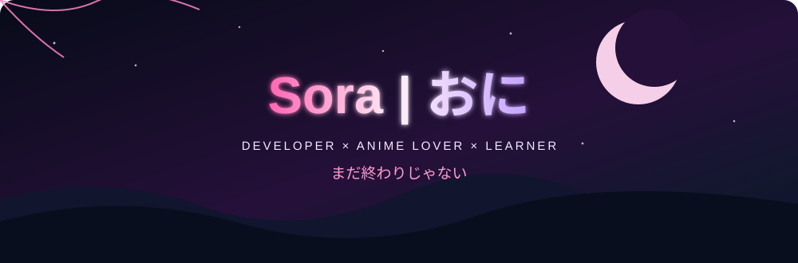

<table width="100%">
  <tr>
    <td width="50%" align="center" valign="middle">
      <!-- Preserves your existing intro design -->
      
    </td>
    <td width="50%" align="center" valign="middle">
      <!-- Preserves your existing animated skills design -->
      
    </td>
  </tr>
</table>

## 🛠️ Tech Stack

  

## 📊 GitHub Stats

  
  

## 🎌 Anime Favorites

  
  
  
  
  

## 🌐 Contact & Socials

  
  <!-- Replace these example social links with your real profiles -->
  
  
  

  <code>root@8toy:~$ echo "Thanks for visiting."</code> 
  <i>「まだ終わりじゃない」 — It's not over yet.</i>

