<div align="center">


<br/><br/>

<table align="center">
  <tr>
    <td align="center" valign="middle">
      
    </td>
    <td align="center" valign="middle">
      
    </td>
  </tr>
</table>

</div>

---

<div align="center">

```bash
root@8toy:~$ echo "Thanks for visiting."
Thanks for visiting.
root@8toy:~$ exit
```


</div>


